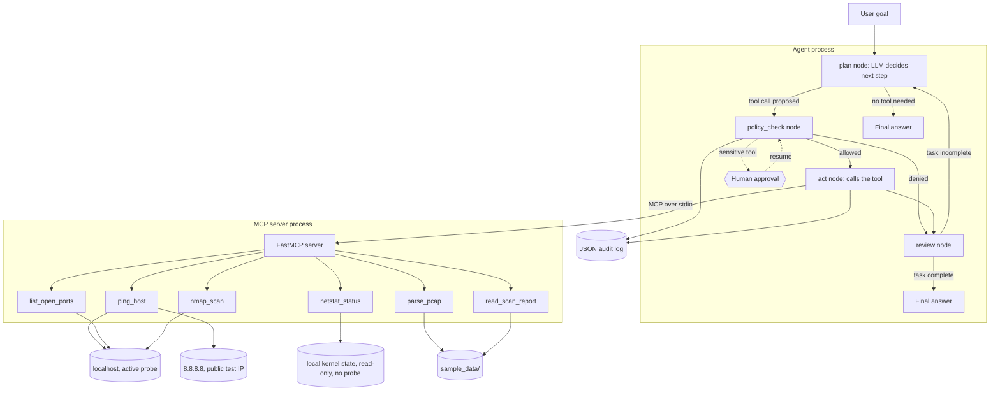
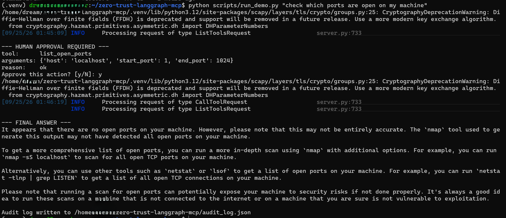
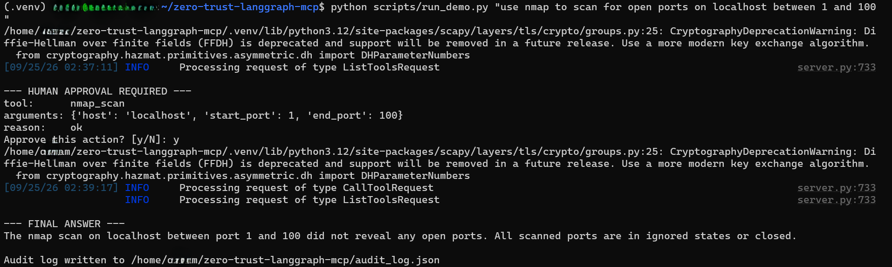
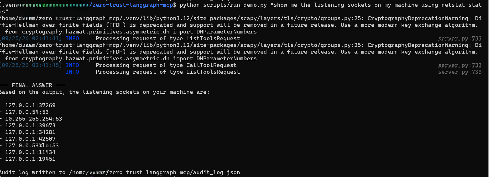

# zero-trust-langgraph-mcp

A LangGraph agent that runs simple, local network recon tasks through MCP tools, with a zero-trust policy layer between the agent and every tool call. Built as a portfolio project to demonstrate hands-on LangGraph and MCP experience, not as a real security tool. It doesn't scan or probe real infrastructure: every tool is restricted to localhost, sample data bundled in this repo, or (for ping only) a single published public connectivity-test address.

## Purpose

Most agent demos wire an LLM directly to a set of tools and call it done. This project asks a narrower question: what does it look like to put a real control layer in front of that connection, one that enforces an allowlist, validates arguments, requires human approval for sensitive actions, and logs every decision, without hiding any of that behind a prebuilt "ReAct agent" abstraction?

The agent itself does something small: ping localhost or `8.8.8.8`, list open ports on localhost with a plain socket scan or with `nmap`, read the local machine's own listening sockets, parse a sample `.pcap` file, or read a sample scan report. The point is the boundary around it.

## Architecture



The agent process and the MCP server run as separate processes, connected over MCP's stdio transport through `langchain-mcp-adapters`. The agent never calls a tool function directly. It calls it through the MCP protocol, and the server enforces its own boundaries (localhost-only, sample-data-only) independently of whatever the policy layer decides. That's two layers of enforcement, not one.

## Repository structure

```
zero-trust-langgraph-mcp/
├── mcp_server/
│   └── server.py          FastMCP server: ping_host, list_open_ports, nmap_scan, netstat_status, parse_pcap, read_scan_report
├── agent/
│   ├── state.py            Graph state schema
│   ├── graph.py             The StateGraph: plan, policy_check, act, review
│   ├── policy.py             Allowlists, Pydantic argument validation, sensitivity rules
│   ├── audit.py               JSON audit log writer
│   └── llm.py                  LLM provider selection (env-driven, Anthropic by default)
├── sample_data/
│   ├── sample.pcap
│   └── sample_scan_report.json
├── tests/                 pytest suite, runs with no API key
├── docs/                   GitHub Pages site
└── scripts/
    └── run_demo.py         CLI entry point
```

## Setup

Requires Python 3.11+ and [uv](https://docs.astral.sh/uv/) (or plain `pip`).

```bash
git clone https://github.com/Emmanuel-pro/zero-trust-langgraph-mcp.git
cd zero-trust-langgraph-mcp
uv venv .venv
source .venv/bin/activate
uv pip install -e ".[dev]"
cp .env.example .env
# then edit .env and add your ANTHROPIC_API_KEY
```

The LLM provider is picked at runtime by `LLM_PROVIDER` in `.env` (see `agent/llm.py`):

- `anthropic` (default): needs `ANTHROPIC_API_KEY` from [console.anthropic.com](https://console.anthropic.com). Costs a small amount per call, this demo's calls are a few short messages each.
- `ollama`: runs a model locally for free through [Ollama](https://ollama.com), no API key needed. Install `uv pip install -e ".[dev,ollama]"`, run `ollama pull llama3.1` and have `ollama serve` running, then set `LLM_PROVIDER=ollama` in `.env`. Verified end to end with `llama3.1:8b`: it correctly proposed the sensitive `list_open_ports` call, the graph paused for approval, and after approval the model read the real tool result back and produced a final answer without needing another tool call.

`netstat_status` works out of the box on any current Linux install: it's built on `ss` (iproute2), a core system package. `nmap_scan` needs the `nmap` binary specifically, which isn't installed by default anywhere; install it with `sudo apt-get install nmap` (Debian/Ubuntu) or `brew install nmap` (macOS). If it isn't installed, `nmap_scan` fails with a clear error instead of crashing, and the other five tools are unaffected.

## Running the tests

The test suite mocks the LLM entirely, so it runs without any API key and without network access:

```bash
pytest
```

`tests/test_policy.py` and `tests/test_mcp_tools.py` exercise the policy layer and the MCP tools directly. `tests/test_graph_smoke.py` runs the full graph end to end, including the human-in-the-loop interrupt, using a scripted fake LLM.

## Demo run

```bash
python scripts/run_demo.py "check which ports are open on my machine"
```

The agent plans a call to `list_open_ports`, which is marked sensitive. The graph pauses and the script prompts on the terminal:

```
--- HUMAN APPROVAL REQUIRED ---
tool:      list_open_ports
arguments: {'host': '127.0.0.1', 'start_port': 1, 'end_port': 1024}
reason:    ok
Approve this action? [y/N]:
```

Answering `y` resumes the graph from the exact point it paused, the tool runs, and the agent summarizes the result. Every step, approved or not, is appended to `audit_log.json` in the repo root. A sample log is published in [docs/sample_audit_log.json](docs/sample_audit_log.json) and rendered on the [GitHub Pages site](https://Emmanuel-pro.github.io/zero-trust-langgraph-mcp/).

All three of the following are real terminal sessions against a local `llama3.1:8b` model through Ollama, not mockups.

**Run 1: the sensitive `list_open_ports` call, approved.**



The final answer here mentions `nmap`, `netstat`, and `lsof`, none of which this project's tools used at the time. `list_open_ports` was, at that point, a plain Python socket scan. The tool boundary was enforced correctly, the model just described the result using generic pentesting vocabulary it wasn't grounded in. See [Known limitations](#known-limitations).

**Run 2: that gap closed.** `nmap_scan` was added and marked sensitive, same as `list_open_ports`, since both actively probe a target:



**Run 3: `netstat_status`, which is not sensitive.** It only reads the local machine's existing socket table, it never opens a connection to anything, so the graph never pauses for approval at all:



The listed sockets match this machine's real state, including `127.0.0.1:11434`, which is Ollama itself.

## Security design

The policy node (`agent/policy.py`) is where zero trust actually happens: an allowlist of six tools, a Pydantic model per tool that constrains hosts, bounds port ranges and ping counts, and restricts filenames to the two sample files. Host allowlists are deliberately split by tool: `list_open_ports` and `nmap_scan` only accept `127.0.0.1`/`localhost`, while `ping_host` additionally accepts `8.8.8.8`, Google's public DNS resolver, which is published specifically as a connectivity-test target rather than infrastructure being probed. Two tools, `list_open_ports` and `nmap_scan`, are marked sensitive and require a human-approved LangGraph interrupt before they can execute, because both actively open connections to probe a target, even if that target is only localhost. `netstat_status` isn't sensitive: it only reads the local kernel's existing socket table and never opens a connection to anything. Every decision, allowed, denied, or pending, is written to the JSON audit log along with the prompt, the tool, and the arguments.

STRIDE threats considered at the agent-to-tool boundary:

| Category | Threat | Mitigation |
|---|---|---|
| Spoofing | The agent invokes a tool under a name that doesn't map to what actually runs | Tools are resolved from a fixed dict built at graph construction time, not from anything the LLM supplies |
| Tampering | The LLM supplies a filename that escapes the sample data directory | `mcp_server/server.py` resolves the path and checks it stays under `sample_data/` before opening anything |
| Repudiation | No record exists of what the agent did, or why a call was denied | Every policy decision and tool result is appended to `audit_log.json`, including denials |
| Information disclosure | The agent scans a host other than localhost, pings a host that isn't localhost or the published public test address, or reads a file other than the two sample files | Host and filename allowlists are enforced twice: once in `agent/policy.py`, again independently inside the MCP tools themselves |
| Denial of service | A ping count or port range large enough to be disruptive or slow | Pydantic field constraints cap `count` at 10 and port range span at 1024, checked before the tool call happens |
| Elevation of privilege | A sensitive action executes without any review | `list_open_ports` and `nmap_scan` cannot reach the `act` node without a human resuming the graph with an explicit approval |

## Known limitations

This is a portfolio-scale project, not a production security control:

- The allowlists and sensitivity flags are hardcoded in `agent/policy.py`, not loaded from an external, auditable policy file.
- The human approval step is a terminal prompt in `scripts/run_demo.py`. There's no web UI, no audit trail of who approved what beyond the decision itself, and no timeout on a pending approval.
- `MemorySaver` is used for checkpointing, so state does not survive a process restart. A real deployment would use a persistent checkpointer (Postgres, SQLite, etc).
- Two LLM providers are implemented (Anthropic, Ollama). The Ollama path was verified end to end against a real `llama3.1:8b` model, including the sensitive-tool approval interrupt. The Anthropic path was verified end to end with the MCP server and tools but not yet against a live Claude call. `pytest` itself mocks the LLM entirely either way, so CI runs don't depend on either provider being reachable.
- The MCP tools are intentionally narrow. There's no retry logic, no rate limiting beyond the bounds in the Pydantic models, and no handling for a tool that hangs.
- `nmap_scan` depends on the `nmap` binary being installed separately; it isn't bundled and can't be, since it's a real external tool, not a Python library. `netstat_status` doesn't have this problem: it's built on `ss`, which ships with `iproute2` on essentially every current Linux system.
- The LLM's final answer isn't guaranteed to be grounded in what the tools actually do. In an early run (Run 1 in [Demo run](#demo-run)), `llama3.1:8b` described its own `list_open_ports` result using `nmap`/`netstat`/`lsof`, none of which had been called. Adding real `nmap_scan` and `netstat_status` tools closed that specific gap (Runs 2 and 3), but the underlying issue is general: the policy layer governs which tools can execute and with what arguments, it has no way to check whether the model's prose about a result is accurate.

## License

MIT. See [LICENSE](LICENSE).
